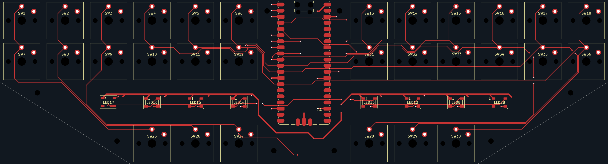

# Steno

A custom 30-key stenography keyboard with a Waveshare RP2040-Plus 16 MB controller, Kailh Choc V1 switches, eight RGB LEDs, and a 3D-printed case with a removable travel cap.

**[V3](V3/) is the latest version.** Earlier electronics designs and case exports are in [archive/](archive/README.md).



## Start here

| What you need | Open |
|---|---|
| Assembly instructions | [Build guide](V3/build-guide.md) |
| Schematic, PCB and parts | [Electronics](V3/hardware/README.md) · [KiCad project](V3/hardware/StenoV3.kicad_pro) · [BOM](V3/hardware/bom.csv) |
| Editable CAD, STL models and printer jobs | [Mechanical guide](V3/mechanical/README.md) |
| Gerbers and drill files | [Fabrication guide](V3/manufacturing/README.md) · [Fabrication ZIP](V3/manufacturing/StenoV3-Gerbers.zip) |
| Javelin configuration and LED diagnostics | [Firmware guide](V3/firmware/README.md) |
| LED tests, visual patterns and prototype results | [LED test guide](V3/firmware/led-tests/README.md) · [Results](V3/firmware/led-tests/results.md) |
| Switch-library credits and licenses | [Reference assets](third_party/README.md) |

## Design files

The [mechanical guide](V3/mechanical/README.md) covers the editable base, protective cap, heat-set-insert coupon, full-length and short LED alignment jig references, keycap references and keyboard assemblies. There are **23 SolidWorks part files and 12 assembly files**, plus STEP references and printable meshes.

For printing, start with [`case-bottom.stl`](V3/mechanical/stl/case-bottom.stl), [`travel-cap.stl`](V3/mechanical/stl/travel-cap.stl) and [`insert-test-coupon.stl`](V3/mechanical/stl/insert-test-coupon.stl). The [SV06/OrcaSlicer profile](V3/mechanical/README.md#sv06-slicing-settings) covers PLA settings and diagonal bed placement. Slice the current travel cap from its STL. Bambu-specific base and insert-coupon printer jobs for A1, P1S and P2S are grouped under [`print-jobs/`](V3/mechanical/print-jobs/).

The [current travel cap](V3/mechanical/README.md#current-travel-cap) has 2.54 mm of added height, full-height loops, centered hooks and a horizontal center hook for the retaining band. Its [standalone SolidWorks part](V3/mechanical/solidworks/travel-cap.SLDPRT) and [STEP solid](V3/mechanical/step/travel-cap.step) are included alongside the STL.

The [LED alignment jig approach](V3/mechanical/README.md#led-alignment-jig) did not work as intended during assembly. CAD and STL files for the full-length eight-opening jig and short four-opening jig are retained as design references. Assemble the LEDs using the [one-pad-first soldering method](V3/build-guide.md#solder-the-rgb-leds).

The [electronics guide](V3/hardware/README.md) explains component packages, the five-row/six-column matrix and the RGB chain. GPIO assignments, switch/diode positions and LED order are also available as CSV tables alongside the KiCad project.

## Repository layout

```text
steno/
├── README.md
├── V3/
│   ├── build-guide.md
│   ├── hardware/        # KiCad project, BOM, pinout and matrix
│   ├── mechanical/
│   │   ├── solidworks/ # Editable parts and assemblies
│   │   ├── step/       # Neutral CAD references
│   │   ├── stl/        # Case, coupon and LED jig reference meshes
│   │   └── print-jobs/ # A1, P1S and P2S base/coupon jobs
│   ├── manufacturing/ # Fabrication ZIP and individual Gerbers/drills
│   ├── firmware/       # Javelin hardware configuration and LED diagnostics
│   └── images/         # Board diagrams and project images
├── archive/            # Earlier electronics versions and case exports
└── third_party/        # Reference-asset credits and license texts
```

## Photos and code

The design files, printable models, build documentation and MicroPython LED diagnostics are available here. The prototype completed the RGB/chase test, 134-cue showcase and 35-cue fast/fade tests at half and full channel levels; see the [LED results](V3/firmware/led-tests/results.md). The [custom Javelin/Lapwing configuration](V3/firmware/javelin/README.md) is now installed on the prototype, with its hardware header, 31-button script and build/packaging instructions included here. The current script also provides [onboard ambient lighting](V3/firmware/javelin/README.md#onboard-lighting): Off and 20%/50%/100% brightness settings, five selectable idle patterns and a green typing indicator with a five-minute idle delay, without a PC helper. On-device configuration and dictionary lookups passed. Photos of the physical parts remain an addition for [`V3/images/`](V3/images/).

## Build, modify and share

You are welcome to build your own keyboard and improve the original designs. Original hardware is licensed under **CERN-OHL-P-2.0**, original project code under **MIT**, and original documentation and images under **CC BY 4.0**. Keep the applicable credit and license notices when sharing. See [LICENSE.md](LICENSE.md) for the scope and full terms.

Third-party components keep their own licenses. In particular, Javelin's **PolyForm Noncommercial** terms still apply to its software and upstream-derived portions; the project licenses do not remove those conditions.

## Credits

[Javelin](https://github.com/jthlim/javelin-steno-pico) by its contributors. Kailh Choc switch footprint and models from [keyswitch-kicad-library](https://github.com/perigoso/keyswitch-kicad-library). See [third_party/](third_party/README.md) for the bundled notices.
