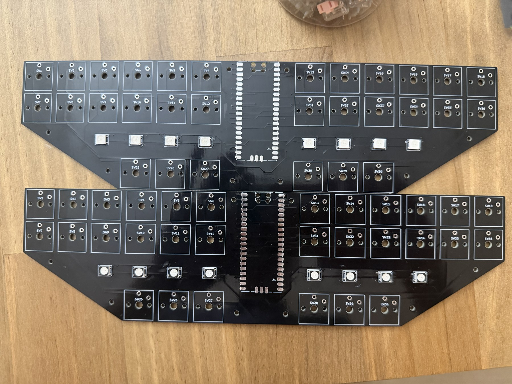
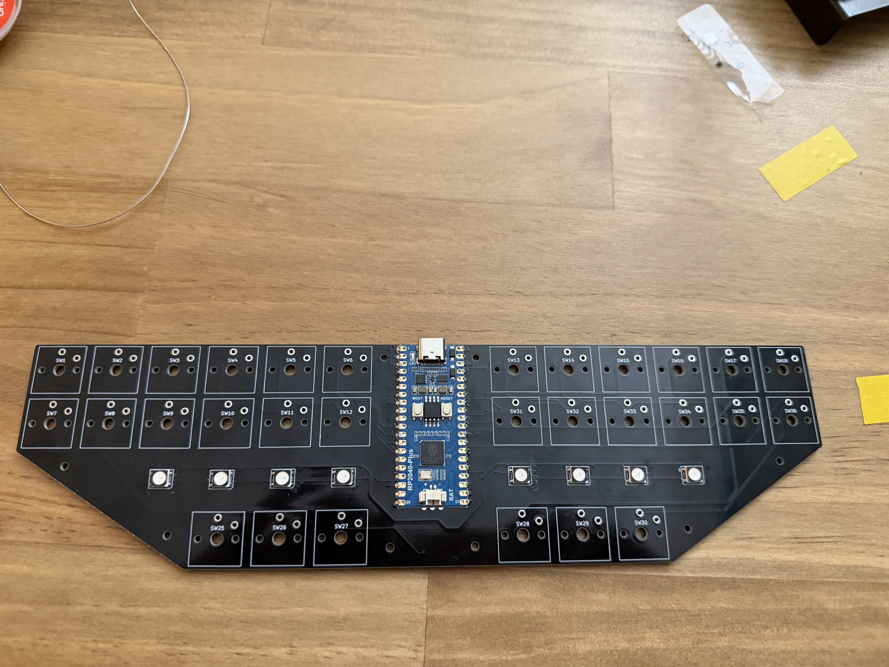
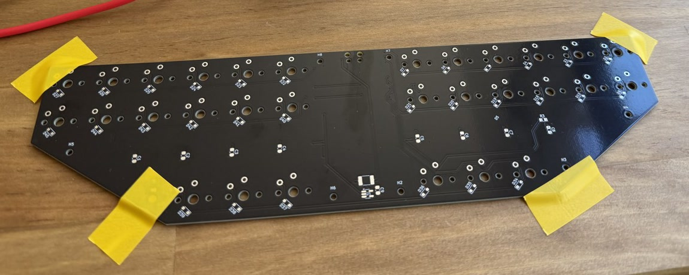
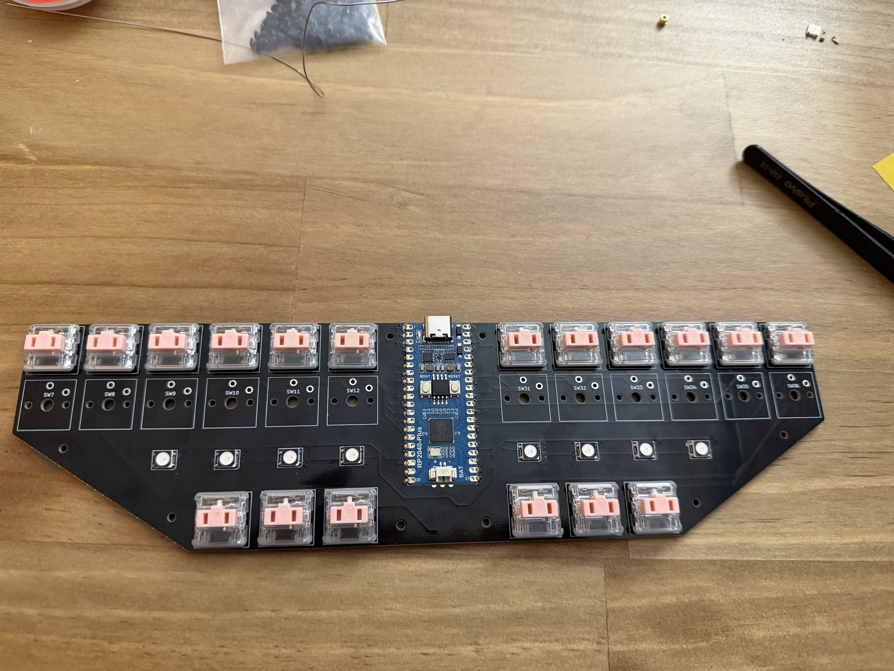
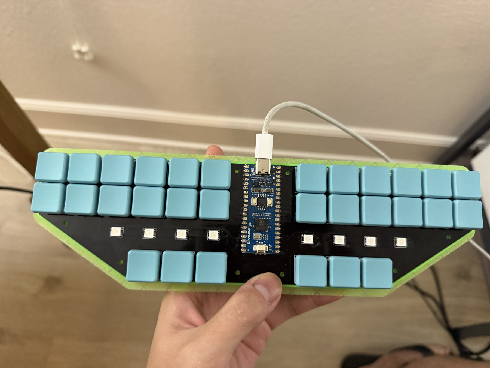

# V3 build guide

This guide covers parts, case printing, soldering, firmware configuration and final assembly.

## 1. Gather the parts

Use the [bill of materials](hardware/bom.csv) for the electronics. The case and assembly materials are:

| Item | Specification |
|---|---|
| Keycaps | 30 Kailh Choc V1-compatible keycaps |
| PCB mounting screws | **Eight M2 × 5 mm machine screws** |
| Heat-set inserts | **Eight M2-thread inserts, 3 mm long and 3.2 mm outside diameter** |
| Printed base, travel cap and insert coupon | **PLA** |
| Cap retention | Rubber bands looped through the cap anchors and under the keyboard/base |
| USB cable | USB-C data cable |

The [mechanical guide](mechanical/README.md#case-hardware-and-materials) covers the screw/insert stack and [print settings](mechanical/README.md#sv06-slicing-settings).

Component packages and suppliers are listed in the [electronics guide](hardware/README.md#component-packages).

## 2. Print the case parts

The [STL files](mechanical/README.md#stl-files) use millimeters. For a Sovol SV06, use the [OrcaSlicer PLA settings and diagonal bed placement](mechanical/README.md#sv06-slicing-settings). [Bambu-specific printer jobs](mechanical/README.md#printer-jobs) are supplied for the base and insert coupon; slice the [current travel cap](mechanical/stl/travel-cap.stl) separately.

Use the insert coupon to select a hole fit for the M2 inserts, then apply it to the base before printing the base and travel cap.

For CAD changes, use the [SolidWorks files](mechanical/README.md#editable-solidworks-files) and export only the printable body. The [current cap part](mechanical/solidworks/travel-cap.SLDPRT) is a standalone solid for direct editing or adding features. Keep reference electronics and switches out of the STL.

## 3. Assemble the electronics

PCB population at two assembly stages.

1. Populate the SMD components and RGB LEDs using the [package table](hardware/README.md#component-packages) and PCB polarity markings.
2. Fit the Waveshare controller with its USB-C connector aligned to the case opening, then solder the castellated pads.
3. Fit and solder the Choc switches, then install the keycaps.

Controller and LEDs installed before fitting the switches.

### Solder the RGB LEDs

The assembly method used for the WS2812Bs is **one pad first**: tin one pad, tack the LED in position, then solder the remaining three contacts. Align LED pin 1 with the footprint.

The [LED alignment jig](mechanical/README.md#led-alignment-jig) was tried with all four pads pre-tinned, but it did not work as intended. Assembly returned to the one-pad-first method above. CAD and STL files for both the full-length and short jigs are retained as design references; printing a jig is not part of the assembly procedure.

Assembly references: [schematic](images/schematic.svg), [front layout](images/pcb-front.svg) and [back layout](images/pcb-back.svg).

PCB underside during assembly.

### Fit the switches and keycaps

Choc switches installed before the keycaps.

## 4. Power and configure the keyboard

The [MicroPython LED tests](firmware/led-tests/README.md) can check the RGB chain before switches are installed. Start with the 16/255 RGB/chase test; [test results](firmware/led-tests/results.md) cover the later brightness and animation runs.

For onboard stenography, use the [Javelin build instructions](firmware/javelin/README.md#reproduce-the-build) and flash the combined custom UF2. Javelin and the MicroPython diagnostics are separate firmware setups.

## 5. Mount the PCB

Seat the M2 inserts flush at the PCB mounting surfaces. Mount the PCB with eight M2 × 5 mm screws, keeping the underside components clear of the base recesses and the screw tips clear of the blind-hole floors.

Completed keyboard with the PCB mounted in the case.

## 6. Fit the travel cap

The [travel cap](mechanical/README.md#current-travel-cap) uses rubber-band retention. Route the band through the loops, under the base and onto a hook, seated behind its tip. The side hooks and horizontal center hook provide alternative attachment points; band tension should hold the cap without depressing the keys.
