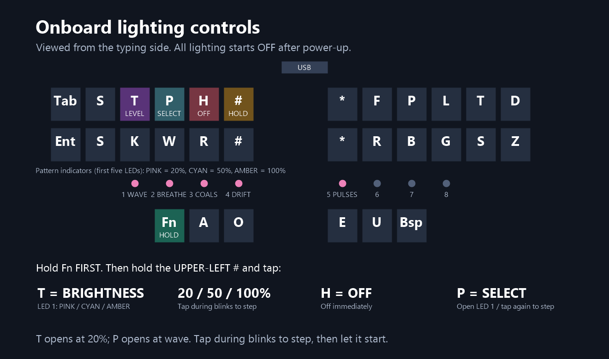
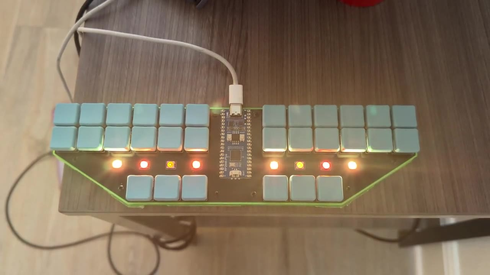

# Steno V3 Javelin / Lapwing

Steno uses embedded Javelin with the Lapwing dictionary preset on a Waveshare RP2040-Plus **16 MB** controller. The [key script](steno_v3.jss) defines the base and Fn layouts and the onboard lighting.

The script compiles to JSS4 bytecode and runs inside Javelin. Animations use the board's timers and PIO/DMA LED driver.

## Physical layout

Viewed from the typing side, USB at the top:

```text
Tab  S  T  P  H  #       *  F  P  L  T  D
Ent  S  K  W  R  #       *  R  B  G  S  Z
        Fn  A  O         E  U  Bsp
```

SW1 is Tab, SW7 is Enter, both S positions produce left S, both left inner keys are #, the two right inner keys remain *, SW25 is hold-Fn, and SW30 is ordinary Backspace. The vowels remain A O E U. The two S keys retain their separate physical steno identities; S1 maps to stroke bit 1 (left S). Asterisk remains steno undo; Backspace deletes characters.

Fn is momentary. Hold the outer-left-thumb key to select:

```text
Esc   -- Brt* Pat* Off* Guard    Home PgUp  Up PgDn End Del
Ent Ctrl Shft Alt Win   --      -- Left Down Right -- --
         Fn   --   --         Spc Ins Bsp
```

`Brt*`, `Pat*` and `Off*` require the upper-left # guard as well as Fn; those keys produce no output by themselves on Fn. Fn + Tab, the upper far-left key, remains Escape. Every other key retains its press-time action and releases that same action even if Fn is released first. Release a steno chord before switching layers.

## Onboard lighting



**All LEDs start off after every power-up**, with 20% brightness selected. Hold the outer-left-thumb **Fn first**, then use the **upper-left #** together with a top-row left-hand selector. The # and selector can go down together or in either order, provided they overlap.

| Selector | Action |
|---|---|
| T | Open brightness selection at 20%; tap during its blinks to step through 50%, 100%, then 20% again. If off, enable original breathing colors. |
| H | Turn all LEDs off immediately |
| P | Open at LED 1; tap again during selection blinks to advance |

Keep Fn + # held while tapping T. Each new brightness selection opens at **20% / pink**. Additional T taps during its five blinks advance to **50% / cyan**, then **100% / amber**, then wrap to 20%. Each tap restarts the five blinks; let them finish to close the selector. Brightness confirmation always uses LED 1. S is unused on Fn; ordinary steno S is unchanged. T keeps the active pattern, or enables breathing when lighting was off.

Keep Fn + # held while tapping P. The first tap opens the selector at LED 1 (Bouncing wave), regardless of the pattern that was running. Further P taps during the five selection blinks advance one choice and restart the blinks. When the five blinks finish, that choice takes effect and the selector closes. The next P tap opens at LED 1 again. For example, choosing coals always takes three taps: wave, breathing, coals. Brightness confirmations do not count as an open P-selection window. A held selector does not auto-repeat; release it before tapping again. The command keys produce no text and add no waiting delay to normal typing.

One of the **first five physical LEDs, left to right**, flashes pink at 20%, cyan at 50%, or amber at 100% to identify the choice:

| Pattern indicator | Choice |
|---|---|
| LED 1 (LED17/index 0) | Bouncing wave |
| LED 2 (LED16/index 1) | Original breathing colors |
| LED 3 (LED15/index 2) | Glowing coals |
| LED 4 (LED14/index 3) | Left-to-right color drift |
| LED 5 (LED13/index 4) | Long-rest pulses |

The selection order is **wave → breathing → coals → drift → long-rest pulses → wave**. Each confirmation uses five 200 ms pulses separated by 200 ms off, at the selected brightness. T brightness selection confirms on LED 1. P pattern selection uses the pattern's LED position. Both use pink for 20%, cyan for 50%, and amber for 100%. Opening P closes the T selection window; opening T closes the P selection window. The next tap of the other selector starts at its first choice. H is immediate off without confirmation. Off is controlled separately with H; lighting starts off after power-up.

| Idle pattern | Behavior |
|---|---|
| Bouncing wave | A soft glow about three LEDs wide travels left to right and back with soft fading edges and fully dark LEDs outside the moving streak. At 20% or 50%, each crossing takes 7 seconds with a 1-second rest at each end; at 100%, 11.2 seconds with 1.6-second rests. Motion eases near the ends, and color blends to the next contrasting palette color during the final rest of each round trip. |
| Original breathing | All LEDs show one color at a time. At 20% or 50%, fade in/out for 5 seconds each; at 100%, 8 seconds each. No peak hold, then 3 seconds dark before the next color. |
| Glowing coals | LEDs independently move between nearly dark red embers and brighter orange peaks. Motion is slower at 100%. |
| Left-to-right drift | A contrasting new color enters at the leftmost LED and gradually replaces the old color toward the right. At 20% or 50%, each LED blends for 3 seconds with a 2-second stagger; a transition starts every 22 seconds. At 100%, these times are 1.6 times longer. |
| Long-rest pulses | Whole-board color pulses, fading up/down for 5 seconds each at 20% or 50%, or 8 seconds each at 100%, followed by 10 seconds completely off. |

### Color palettes

| Pattern | Color scheme |
|---|---|
| Breathing and long-rest pulses | **Red → orange → yellow → green → cyan → blue → purple → pink**, then repeat. All LEDs use the same color together. Both patterns share this palette; their dark pauses differ. |
| Bouncing wave and left-to-right drift | **Red → cyan → orange → blue → green → magenta → gold → violet**, then repeat. The contrasting sequence makes each new color easy to distinguish as it moves across the board. Wave blends to the next color during the final endpoint rest of each round trip; drift brings it in from the left. |
| Glowing coals | A warm **near-dark red to bright orange** range, with each LED changing independently. This effect stays within the ember palette rather than cycling through the rainbow. |

The selector's **pink / cyan / amber** flashes identify **20% / 50% / 100% brightness**. Those are temporary confirmation colors, separate from the selected pattern's palette. Brightness scales all LEDs in the pattern and the green typing indicator; changing brightness keeps the chosen pattern unless lighting was Off. The [lighting script](steno_v3.jss) contains the exact RGB values for customization.

Typing immediately selects **steady green at the chosen 20%, 50%, or 100% brightness**, for every enabled pattern. Green remains while keys are held and for **five minutes after the last release**, then fades to black over 2 seconds and returns to the selected idle effect. Selecting a pattern starts it after confirmation so it can be seen immediately; typing afterward begins the five-minute hold. `IDLE_DELAY_MS = 300000` controls that delay.

USB suspend/disconnection turns lighting off. Settings are not repeatedly written to flash: power-up returns to Off and 20%, and lighting must be deliberately selected again.

All frames, including per-LED patterns, share a conservative **320 mA estimated LED-current budget** after brightness scaling. This is a calculation, not a measurement; controller and LED idle draw are additional. The firmware declares a 500 mA USB budget. Keep the frame limiter when adding effects.

### Lighting demonstration

<a href="../../images/videos/lighting-idle-and-key-activity.mp4">
  
</a>

[Watch the lighting respond to key presses](../../images/videos/lighting-idle-and-key-activity.mp4).

Warm idle lighting followed by the green response to key activity on the green-base build. The [front-page demonstration](../../../README.md#onboard-lighting) shows lighting on the pink-base build.

## Configuration and previous versions

[`key-matrix.csv`](key-matrix.csv) maps switch references to Javelin indexes; [`layout.json`](layout.json) supplies visual geometry. The [`hardware header`](steno_v3.h) scans GP0-GP4 cathode rows and GP5-GP10 pulled-up columns; GP22 drives eight LEDs. BOOTSEL remains index 28. The key script defines the layer actions and lighting behavior.

The [previous magenta v2 script](previous/steno_v3-layout-v2.jss) is available for rollback with the same S1 mapping. The [v1 script](previous/steno_v3-layout-v1.jss) requires restoring S1 to stroke bit 0 (#); replacing that script alone is insufficient. Earlier v1/v2 UF2 files do not include ambient lighting.

For a keyboard already running this custom hardware build, update only the compiled 31-button script and matching stored source through Javelin's supported script/flash tools. Back up the current script first and retain dictionary/configuration data. A full combined UF2 build below is for reproducing the entire installation; export any user dictionary before replacing full firmware/data.

## Dictionary preset

The official [builder](https://lim.au/#/software/javelin-steno) supplies the dictionary/system/host-layout data. The initial preset follows [Lapwing's Javelin setup](https://lapwing.aerick.ca/Appendix-C.html).

| Priority | Dictionary | Initially enabled |
|---|---|---|
| 1 | Emily's Symbols | Yes |
| 2 | abby-left-hand-modifiers.json | Yes |
| 3 | emily-modifiers.json | Yes |
| 4 | Jeff's Phrasing | Yes |
| 5 | Jeff's Numbers | No |
| 6 | lapwing-javelin-additions.json | Yes |
| 7 | lapwing-semi-modal-movement.json | No |
| 8 | lapwing-commands.json | Yes |
| 9 | lapwing-numbers.json | Yes |
| 10 | lapwing-uk-additions.json | Yes |
| 11 | lapwing-proper-nouns.json | Yes |
| 12 | lapwing-base.json | Yes |

The supplied preset uses the US Windows Alt host layout, default keyboard protocol and spaces before output. Repeat and reverse lookup tables are enabled; First Up, Jeff's Modifiers and Show-Stroke are disabled. Emily's Symbols uses AO spacing. The movement and Jeff's Numbers dictionaries can be enabled as needed. Choose a [host layout](https://github.com/jthlim/javelin-host-layouts) matching your operating system and keyboard layout when preparing your own data image.

## Reproduce the build

Build dependencies and generated binaries are not bundled. Upstream license terms are listed in [LICENSE.md](../../../LICENSE.md#third-party-exceptions).

| Component | Tested revision/version |
|---|---|
| [javelin-steno-pico](https://github.com/jthlim/javelin-steno-pico) | da5eb7ca467714f9f8caa01f60eff69025082659 |
| [javelin-steno](https://github.com/jthlim/javelin-steno) | e093126aed38e062ce4b646d92ba99a956e0b6d0 |
| [javelin_steno_script](https://github.com/jthlim/javelin_steno_script) | f3a66d46ebf87609d2b9ba45a8af73802fb7805e |
| Pico SDK | 2.3.1, 079c6f39023649b154152db30f1d781e884879bc |
| TinyUSB (SDK submodule) | 86ad6e56c1700e85f1c5678607a762cfe3aa2f47 |
| Arm GNU Toolchain | 15.2.rel1 |
| CMake / Ninja | 4.4.4 / 1.13.2 |
| Dart SDK | 3.13.7 |

1. Clone those revisions, initialize the SDK's TinyUSB submodule, and link or copy the engine into `javelin-steno-pico/javelin` as upstream describes. Copy `steno_v3.h` into `javelin-steno-pico/config/`.
2. Set `PICO_SDK_PATH` and `PICO_TOOLCHAIN_PATH` for the shell, with the compiler and Ninja on PATH. From the Pico bindings checkout:

   ```powershell
   cmake -S . -B build -G Ninja -DJAVELIN_BOARD=steno_v3 -DPICO_BOARD=waveshare_rp2040_plus_16mb -DPICO_PLATFORM=rp2040 -DPICO_NO_PICOTOOL=1 -DCMAKE_BUILD_TYPE=Release
   cmake --build build --parallel 6
   ```

   The hardware binary is `build/javelin-steno-pico.bin`. `PICO_NO_PICOTOOL` suppresses the SDK's UF2 conversion; the packager below creates the combined UF2.
3. Copy the official script compiler repository's `lib/` into this directory's `compiler/lib/`. The included minimal pubspec builds the upstream pure Dart compiler without its Flutter editor. From `compiler/`:

   ```powershell
   dart pub get
   dart run bin/compile.dart ../steno_v3.jss ../steno_v3-script.bin
   ```

   This emits a **JSS4 script for 31 buttons**, including both layers, onboard ambient lighting and BOOTSEL. A stock Uni v4 builder compiles only 29 buttons; using that bytecode unmodified would lose the two extra keys.
4. In the official builder, select The Uni v4 **as a data-image template only**, add the Lapwing bundle, and use the preset above. The packager sets top S back to S and embeds the supplied custom script/source independently of the template’s layout options. Create and download a full firmware image. Do not flash that stock hardware image to this PCB.
5. From this directory, combine the downloaded data with the custom hardware and 31-button script:

   ```powershell
   python package.py --builder path/to/downloaded.uf2 --hardware path/to/javelin-steno-pico.bin --script steno_v3-script.bin --source steno_v3.jss --output steno-v3-javelin-layout-v2.uf2 --top-s-as-s
   ```

   The packager combines the custom hardware and script with the builder's system, word list, host layouts and dictionaries, and writes a SHA-256 sidecar. The image fits the 16 MB flash; Javelin initializes the final 256 KB user-dictionary area on first boot.

Use the local [first-word typing page](first-words.html) for the initial S, T, H-L and undo exercise.

## Install and check

Flash **the combined custom UF2** through the RP2040 BOOTSEL drive (`RPI-RP2`). This replaces MicroPython; lighting starts off after restart.

Use the [Javelin web tools](https://lim.au/#/software/javelin-steno) for settings, dictionaries, key state and paper tape. Check the mapped steno and Fn actions against the [physical layout](#physical-layout). A stock Uni firmware update would replace this PCB's custom hardware configuration.

To return to the saved light demos, reinstall the correct Waveshare RP2040-Plus 16 MB MicroPython firmware and use the [LED test launcher](../led-tests/README.md). Returning to Javelin uses the combined custom UF2 again; export any user dictionary before reinitializing firmware/data.
