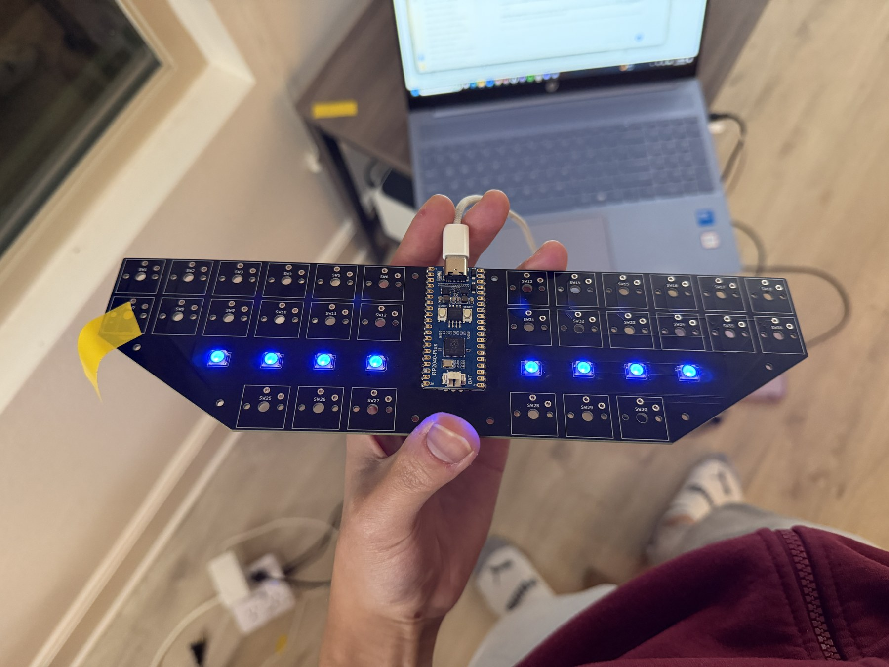

# LED tests and visual patterns

Run these diagnostics on the **Waveshare RP2040-Plus 16 MB with MicroPython**, before installing Javelin or when troubleshooting the RGB chain. They drive GP22 and eight WS2812Bs; switches are not needed. The scripts are diagnostic programs, not Javelin firmware.

See the [test results](results.md) for recorded RGB, brightness and animation runs.

## Board demonstration



The controller and RGB chain can be checked before installing switches.

https://github.com/user-attachments/assets/39385478-dcb2-4bba-a9ec-e549e90830cb

RGB chase test on the board before switch installation.

## Hardware and LED order

`GP22 → U1 buffer → R3 (330 Ω) → eight WS2812Bs`

The LED supply passes through F1. Nine 100 nF capacitors provide local bypassing for the eight LEDs and buffer. The tested order is left to right, four LEDs per half:

| Position | Pixel index | Reference |
| --- | ---: | --- |
| 1 | 0 | LED17 |
| 2 | 1 | LED16 |
| 3 | 2 | LED15 |
| 4 | 3 | LED14 |
| 5 | 4 | LED13 |
| 6 | 5 | LED12 |
| 7 | 6 | LED8 |
| 8 | 7 | LED28 |

## Choose a test

| File | Purpose |
| --- | --- |
| [steno-led-test.py](steno-led-test.py) | Initial all-pixel RGB and individual RGB chase at 16/255; finishes off. |
| [steno-led-showcase.py](steno-led-showcase.py) | 134 labeled demos: mapping, 22 colors, brightness comparisons, motion, symmetry, textures, synthetic beats, detail comparisons and flashes. |
| [steno-led-energy.py](steno-led-energy.py) | Optional 35-cue extension: fades, rapid stripes/chases, random colors, synthetic rhythms and flashes. Load it through the launcher after the base renderer. |
| [run.py](run.py) | Computer-side launcher: explicit USB port selection, labels, logs, level/speed selection and stopping. |

The full base catalog takes about 18:53. The fast extension takes about 3:49. See [catalog.md](catalog.md) for IDs and [energy-catalog.md](energy-catalog.md) for the extra 35 cues.

## Install MicroPython and run the first test

Use the **16 MiB Flash** MicroPython build from the [Waveshare RP2040-Plus download page](https://micropython.org/download/WAVESHARE_RP2040_PLUS/). The reference runs used MicroPython 1.29.0. Installing it replaces Javelin; export any user dictionary and settings before changing firmware.

Run `steno-led-test.py` on the board, for example through [Thonny](https://thonny.org/). It tests all-pixel RGB and the individual chase at 16/255, then turns the LEDs off.

## Run labeled sections from a computer

From this directory:

```powershell
py -m pip install -r requirements.txt
py run.py --list
py run.py --section colors --prepare-only
```

Replace `COM4` with the board's serial port:

```powershell
py run.py --port COM4 --section colors
py run.py --port COM4 --section motion --level 128
py run.py --port COM4 --energy --level 128
py run.py --port COM4 --energy --level 255
py run.py --port COM4 --energy --pattern energy-out-24 --level 128 --repeat 3
py run.py --port COM4 --all
```

The port must identify a MicroPython RP2040 (VID 0x2E8A, PID 0x1020). Add `--serial YOUR_SERIAL` to require a particular board identity. Program payloads, session markers and logs are under this directory's ignored `work/` folder.

Stop with Ctrl+C or `py run.py --stop`; `py run.py --status` reports the current cue. Normal completion and interruption turn the LEDs off. A forcibly terminated launcher can leave a stale session marker in `work/`.

## Brightness, color and speed

The first test uses **16/255 (6.3% raw channel level)**. Normal showcase animations use **64/255 (25.1%)**. The extension defaults to **128/255 (50.2%)**; `--level 255` requests full output. Fades and trails vary below the chosen peak. These are digital channel settings, not perceived-brightness percentages.

Brightness sweeps use 1, 2, 4, 8, 16, 24, 32, 48, 64, 96, 128, 160, 192, 224 and 255. Base brightness/flash cues retain fixed labeled levels and reject a level override. The fast extension allows the requested override, including its flashes. White is excluded; the base showcase includes non-white pastels.

Every rendered frame retains an estimated **320 mA light-producing-channel limit**, based on 20 mA per full channel. Demanding frames are scaled down and counted in the summary. Adding a 100 mA planning reserve gives approximately 420 mA; actual USB current, fuse rating and port allocation were not measured. The BOM fuse is the design value; the builder reported possibly fitting a 750 mA part, which remains unconfirmed. Do not treat the software limiter as hardware protection or the fuse as a USB power allocation.

Playback speed can be selected from 0.25 to 4. It also changes labeled BPM/flash rates relative to their speed-1 values. Fast-motion rates are animation targets, not measured timing guarantees. Flash demos include rapid 8/12/16 Hz changes; the base flash section has a five-second dark countdown. Other beat and random-color effects also contain abrupt changes.

## Scope of these demos

Beat/BPM and bass/mid/treble effects use synthetic events, without audio capture or FFT. Four-zone effects group the eight physical LEDs into neighboring pairs. These MicroPython effects are separate from the Javelin lighting script.

See the [firmware guide](../README.md) for the separate Javelin configuration and the [build guide](../../build-guide.md) for assembly.
