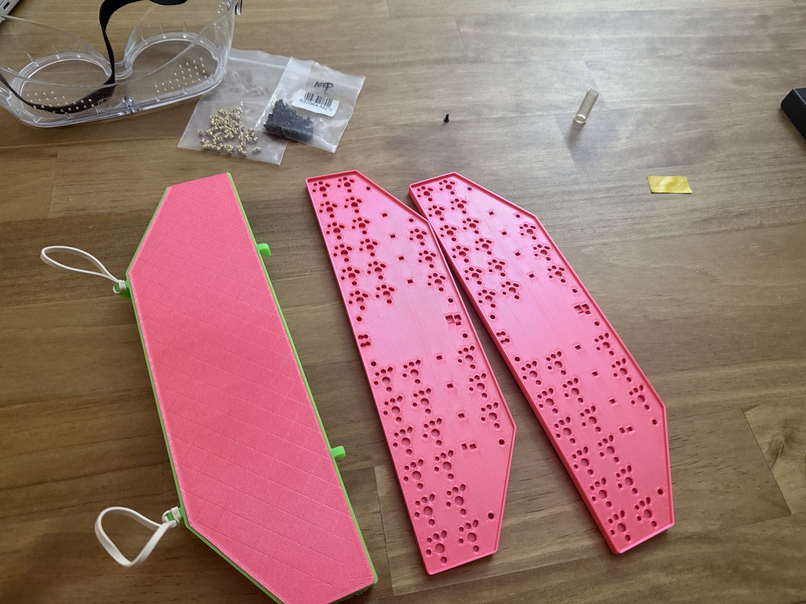
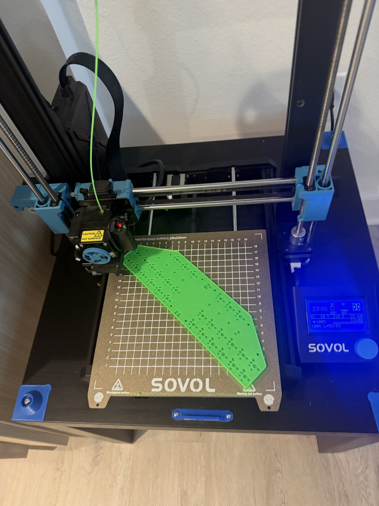
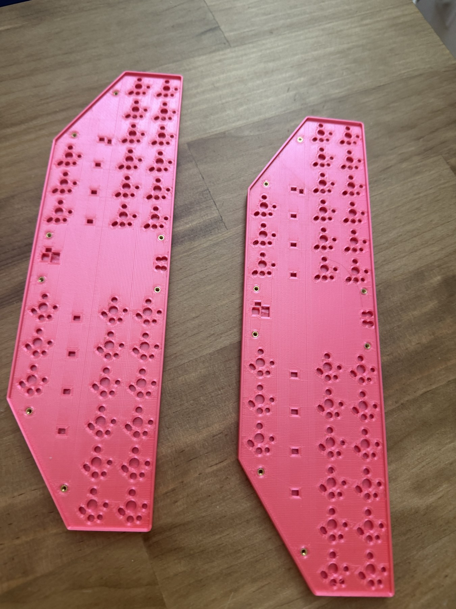
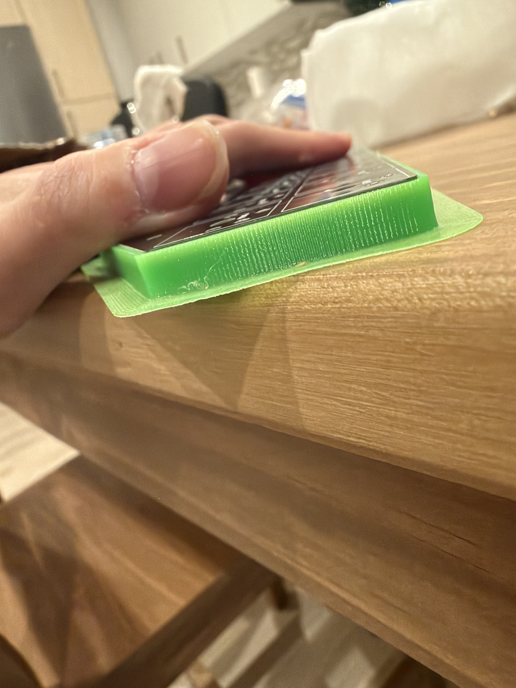
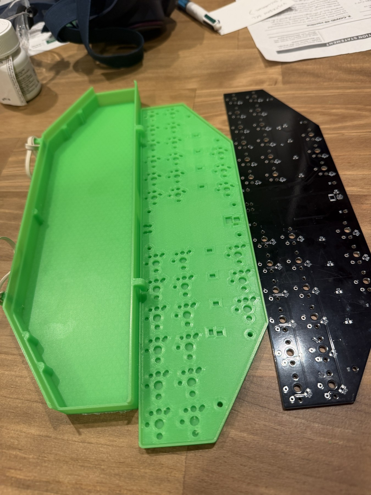

# Mechanical design and printing

The case base and travel cap are supplied as editable CAD and printable models. This folder also includes an insert-fit coupon, LED alignment jig references, keycap references and keyboard assemblies.

Travel cover with two example case bases.

## File formats

| Folder | Contents | Use |
|---|---|---|
| [`solidworks/`](solidworks/) | SolidWorks parts (`.SLDPRT`) and assemblies (`.SLDASM`) | Edit parts and work with the keyboard assembly |
| [`step/`](step/) | Travel cap, PCB assembly and keycap STEP files | Exchange cap geometry and position references in CAD |
| [`stl/`](stl/) | Base, travel cap, insert coupon and two LED jig references | Slice printable geometry |
| [`print-jobs/`](print-jobs/) | Base and insert-coupon jobs for A1, P1S and P2S | Print using a matching printer setup |

Earlier base and cap meshes, plus jobs for the previous cap, are in [`archive/prints/`](../../archive/prints/), described in the [archive guide](../../archive/README.md).

## Editable SolidWorks files

| File | Purpose | Printable model |
|---|---|---|
| `Bottom Prototype.SLDPRT` | Base design with reference geometry | Use the part-only base for printing |
| `BottomCasePARTONLYV1.SLDPRT` | Part-only base | [case-bottom.stl](stl/case-bottom.stl) |
| [travel-cap.SLDPRT](solidworks/travel-cap.SLDPRT) | Current standalone protective travel cap | [travel-cap.stl](stl/travel-cap.stl) |
| `TestPrintHoles.SLDPRT` | Heat-set-insert coupon | [insert-test-coupon.stl](stl/insert-test-coupon.stl) |
| [LEDAlignmentJig.SLDPRT](solidworks/LEDAlignmentJig.SLDPRT) | Full-length jig with eight LED openings; design reference | [led-alignment-jig.stl](stl/led-alignment-jig.stl) |
| [LEDAlignmentJigShort.SLDPRT](solidworks/LEDAlignmentJigShort.SLDPRT) | Short jig with four LED openings; design reference | [led-alignment-jig-short.stl](stl/led-alignment-jig-short.stl) |
| `ChocKeyCap.SLDPRT` | Keycap reference | Reference geometry |
| `StenoFullASMV1.SLDASM` | Keyboard assembly | Assembly reference |
| `StenoFullASMV1SINGLEPART.SLDPRT` | Single-part keyboard reference | Assembly reference |
| `TopCaseV1.SLDPRT`, `TopCaseV2.SLDPRT`, `TopCaseV3.SLDPRT` | Earlier cap iterations; original filenames retained for assembly references | Earlier design references |

The directory also contains PCB, controller, switch, terminal, LED, diode, resistor, capacitor, fuse and buffer-package models used with these assemblies. Files ending in `.step.SLDPRT` or `.step.SLDASM` are native representations of those components.

The assemblies reference components in `solidworks/` and `step/`. Use SolidWorks Pack and Go when copying or renaming linked CAD files.

For print exports, select only the printable body and use **millimeters**; the native models can also contain reference electronics and switches.

## Current travel cap

Use [travel-cap.SLDPRT](solidworks/travel-cap.SLDPRT), [travel-cap.step](step/travel-cap.step) or [travel-cap.stl](stl/travel-cap.stl) for the current cover. These contain only the cap body. The SolidWorks file contains a standalone solid rather than the original sketch/feature history; use direct editing or add features for further changes.

The cap adds **2.54 mm (0.1") of height** over the previous design. The hooks and loops are on the opposite sides from the previous cap, the loops span the taller walls, and the hooks are centered vertically. A horizontal hook sits between the two loops to provide another retaining-band attachment point.

The earlier cap's mesh and sliced jobs are in the [archive guide](../../archive/README.md#previous-travel-cap).

## STEP references

- [`travel-cap.step`](step/travel-cap.step): current standalone travel cap for use in other CAD tools.
- [`pcb-assembly.step`](step/pcb-assembly.step): PCB assembly for positioning the electronics inside the case.
- [`Choc_Stem_Choc_Size_Normal.step`](step/Choc_Stem_Choc_Size_Normal.step): keycap reference geometry.

The PCB assembly uses generic Pico reference geometry. The Waveshare controller fits with its USB-C socket aligned to the case opening.

## STL files

Mesh dimensions are in **millimeters**.

| Model | Size (mm) | Purpose |
|---|---|---|
| [case-bottom.stl](stl/case-bottom.stl) | 254.286 × 70.286 × 6.336 | Keyboard base |
| [travel-cap.stl](stl/travel-cap.stl) | 254.286 × 87.355 × 22.973 | Current protective travel cap |
| [insert-test-coupon.stl](stl/insert-test-coupon.stl) | 6.350 × 48.260 × 5.080 | Insert hole-fit coupon |
| [led-alignment-jig.stl](stl/led-alignment-jig.stl) | 245.447 × 30.873 × 3.175 | Full-length, eight-opening LED jig reference |
| [led-alignment-jig-short.stl](stl/led-alignment-jig-short.stl) | 104.958 × 32.137 × 3.175 | Short, four-opening LED jig reference |

The travel-cap mesh has an offset origin. The insert coupon provides hole-size options for fitting the M2 heat-set inserts before printing the base.

## LED alignment jig

Two LED alignment jig designs are included: the [full-length jig](stl/led-alignment-jig.stl) has eight LED openings, and the [short jig](stl/led-alignment-jig-short.stl) has four. They were designed to hold LED packages in position while soldering. The intended approach was to tin all four PCB pads, position the LEDs with the jig, and reheat each pad to join the contacts.

**The jig approach did not work as intended during assembly.** Assembly returned to conventional hand soldering without a jig: tin one pad, position and tack the LED, then solder the remaining three contacts. Follow the [LED soldering steps in the build guide](../build-guide.md#solder-the-rgb-leds).

The [full-length SolidWorks part](solidworks/LEDAlignmentJig.SLDPRT), [short SolidWorks part](solidworks/LEDAlignmentJigShort.SLDPRT) and their STL files remain available as design references. Neither jig is required for assembly. The native parts include keyboard reference geometry; export only the jig body when creating a new STL. Both jig meshes have a Z offset; their broad flat face is the print-bed surface.

## SV06 slicing settings

The base was printed in PLA on a **Sovol SV06** using the following OrcaSlicer settings. Its 220 × 220 mm bed requires diagonal placement of the base and cap.

| Setting | Case-printing profile |
|---|---|
| Material / nozzle | Generic PLA, 1.75 mm filament / 0.4 mm nozzle |
| Nozzle / bed temperature | 220°C / 55°C |
| Layer height / first layer | 0.12 mm / 0.20 mm |
| Walls / top / bottom layers | 3 / 3 / 3 |
| Infill | 20% Triangles |
| First layer / first-layer infill | 15 / 20 mm/s |
| Outer / inner walls | 25 / 35 mm/s |
| Top surface / sparse infill | 20 / 45 mm/s |
| Small perimeters / gap infill | 15 / 20 mm/s |
| Travel / first-layer travel | 80 / 60 mm/s |
| Normal / outer-wall / top / first-layer acceleration | 500 / 300 / 300 / 300 mm/s² |
| Travel acceleration | 400 mm/s² |
| Brim | Outer only, 5 mm wide, 0.10 mm object gap |
| Travel planning | Avoid crossing walls enabled |

Rotate the base and cap **approximately 45° in the XY plane** to fit the bed. Their rotated footprints are approximately **204 × 204 mm** and **206.5 × 206.5 mm**; with a 5 mm outer brim, these become about **214 × 214 mm** and **216.5 × 216.5 mm**.

The base printing diagonally on the Sovol SV06.

## Printer jobs

The following pre-sliced jobs are **Bambu-specific alternatives** with their own saved settings. They are not SV06 G-code or the SV06 profile above. Each printer has a base and insert-coupon job. **Slice the current travel-cap STL separately**; the earlier cap jobs are retained in the [archive](../../archive/README.md#previous-travel-cap).

| Printer | Base | Insert coupon |
|---|---|---|
| Bambu A1 | [Base](print-jobs/A1/case-bottom.gcode.3mf) | [Coupon](print-jobs/A1/insert-test-coupon.gcode.3mf) |
| Bambu P1S | [Base](print-jobs/P1S/case-bottom.gcode.3mf) | [Coupon](print-jobs/P1S/insert-test-coupon.gcode.3mf) |
| Bambu P2S | [Base](print-jobs/P2S/case-bottom.gcode.3mf) | [Coupon](print-jobs/P2S/insert-test-coupon.gcode.3mf) |

These `.gcode.3mf` files use the named printer's **Bambu PLA Basic** profile with a **0.4 mm nozzle, textured PEI plate and 0.12 mm layer height**. The saved settings are consistent across the A1, P1S and P2S jobs:

| Part | Wall loops | Infill | Supports |
|---|---:|---|---|
| Base | 5 | 20% gyroid | Automatic tree supports enabled |
| Insert coupon | 3 | 15% gyroid | Automatic tree supports enabled |

## Case hardware and materials

| Item | Specification |
|---|---|
| Printed parts | PLA base, travel cap and insert coupon |
| Mounting screws | Eight **M2 × 5 mm** machine screws |
| Heat-set inserts | Eight **M2 internal thread × 3 mm length × 3.2 mm outside diameter** |
| PCB mounting holes | Eight 2.2 mm clearance holes through the 1.6 mm PCB |
| Cap retention | Rubber bands, routed through the cap anchors and under the keyboard/base |

Brass heat-set inserts installed in two example bases.

An M2 × 5 mm screw extends approximately 3.4 mm past the 1.6 mm PCB. The 3 mm inserts seat flush at the PCB mounting surfaces, with clearance beneath the screw tips. Use the coupon to choose the installation-hole size for the 3.2 mm-OD inserts.

Ordinary rubber bands retain the cap through its loops and hooks, passing under the base. See the [build guide](../build-guide.md#6-fit-the-travel-cap) for the band routing.

## Earlier enclosure reference

These photographs and the fit demonstration show an earlier enclosure. Use the [current travel cap files](#current-travel-cap) when printing the cover.

Side-profile PCB fit in an earlier print, with its brim still attached.

Earlier cover, base and PCB shown separately.

https://github.com/user-attachments/assets/afd2523c-cdcb-4bce-90de-52b5e9e94dbe

Earlier travel cover fitted over the PCB and base.
